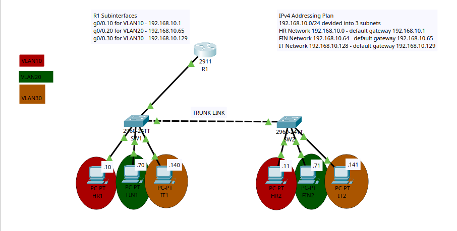
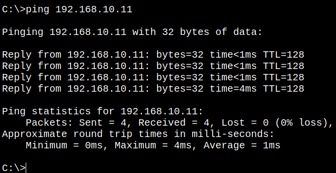
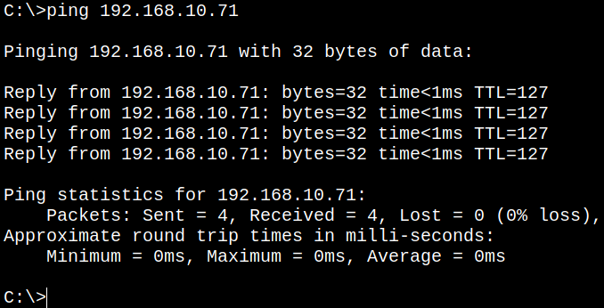
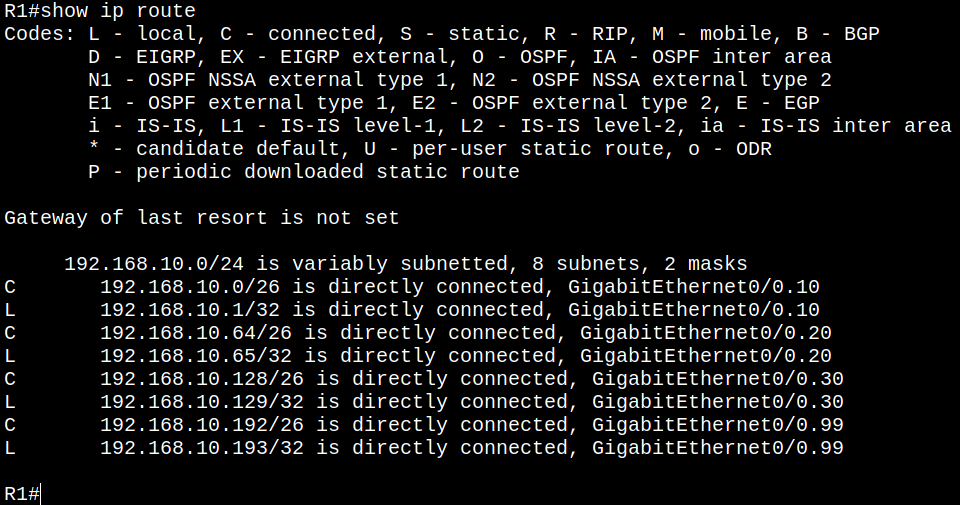

# CCNA Lab 01 — VLANs, Trunking & Router-on-a-Stick

## Overview

This project is a hands-on Cisco Packet Tracer lab built as part of my CCNA 200-301 self-study.

The lab simulates a small company network with three departments: HR, Finance, and IT. Each department is assigned its own VLAN and IPv4 subnet. Inter-VLAN communication is provided using Router-on-a-Stick, while a dedicated management VLAN is used for switch management.

The network was configured, tested, saved, and reopened successfully in Cisco Packet Tracer.

## Objectives

- Configure and manage VLANs.
- Assign access ports to the correct VLANs.
- Configure 802.1Q trunk links.
- Configure native VLANs and allowed VLAN lists.
- Disable DTP on switch trunk ports.
- Implement Router-on-a-Stick inter-VLAN routing.
- Practice IPv4 subnetting using /26 networks.
- Configure switch management SVIs.
- Apply basic device security.
- Configure PortFast and BPDU Guard on access ports.
- Shut down unused switch ports.
- Verify connectivity and troubleshoot network configurations.

## Network Topology

The network consists of:

- 1 Cisco 2911 router
- 2 Cisco 2960 switches
- 6 PCs



### Physical Connections

| Connection | Interfaces |
|---|---|
| R1 — SW1 | R1 G0/0 ↔ SW1 G0/1 |
| SW1 — SW2 | SW1 G0/2 ↔ SW2 G0/1 |
| HR-PC1 — SW1 | SW1 F0/1 |
| FIN-PC1 — SW1 | SW1 F0/2 |
| IT-PC1 — SW1 | SW1 F0/3 |
| HR-PC2 — SW2 | SW2 F0/1 |
| FIN-PC2 — SW2 | SW2 F0/2 |
| IT-PC2 — SW2 | SW2 F0/3 |

## VLAN Design

| VLAN | Name | Department | Network | Gateway |
|---:|---|---|---|---|
| 10 | HR | Human Resources | 192.168.10.0/26 | 192.168.10.1 |
| 20 | FINANCE | Finance | 192.168.10.64/26 | 192.168.10.65 |
| 30 | IT | Information Technology | 192.168.10.128/26 | 192.168.10.129 |
| 99 | MANAGEMENT | Network Management | 192.168.10.192/26 | 192.168.10.193 |

All VLANs use the subnet mask `255.255.255.192` (`/26`).

## IP Addressing

### End Devices

| Device | VLAN | IP Address | Subnet Mask | Default Gateway |
|---|---:|---|---|---|
| HR-PC1 | 10 | 192.168.10.10 | 255.255.255.192 | 192.168.10.1 |
| HR-PC2 | 10 | 192.168.10.11 | 255.255.255.192 | 192.168.10.1 |
| FIN-PC1 | 20 | 192.168.10.70 | 255.255.255.192 | 192.168.10.65 |
| FIN-PC2 | 20 | 192.168.10.71 | 255.255.255.192 | 192.168.10.65 |
| IT-PC1 | 30 | 192.168.10.140 | 255.255.255.192 | 192.168.10.129 |
| IT-PC2 | 30 | 192.168.10.141 | 255.255.255.192 | 192.168.10.129 |

### Network Devices

| Device | Interface | IP Address | VLAN |
|---|---|---|---:|
| R1 | G0/0.10 | 192.168.10.1/26 | 10 |
| R1 | G0/0.20 | 192.168.10.65/26 | 20 |
| R1 | G0/0.30 | 192.168.10.129/26 | 30 |
| R1 | G0/0.99 | 192.168.10.193/26 | 99 |
| SW1 | VLAN 99 SVI | 192.168.10.194/26 | 99 |
| SW2 | VLAN 99 SVI | 192.168.10.195/26 | 99 |

The switches use `192.168.10.193` as their management default gateway.

## Technologies Implemented

### VLANs and Access Ports

Created VLANs 10, 20, 30, and 99 on both switches.

PC-facing ports were configured as access ports and assigned to their respective VLANs.

### Trunking

Configured trunk links between:

- SW1 and SW2
- SW1 and R1

Trunk configuration includes:

- 802.1Q trunking
- Native VLAN 99
- Allowed VLANs: 10, 20, 30, and 99
- DTP disabled on switch trunk ports

### Router-on-a-Stick

Configured R1 with four subinterfaces on G0/0:

| Subinterface | VLAN | IP Address |
|---|---:|---|
| G0/0.10 | 10 | 192.168.10.1/26 |
| G0/0.20 | 20 | 192.168.10.65/26 |
| G0/0.30 | 30 | 192.168.10.129/26 |
| G0/0.99 | 99 | 192.168.10.193/26 |

802.1Q encapsulation was configured on each subinterface, with VLAN 99 configured as the native VLAN.

This allows communication between different VLANs through R1.

### Switch Management

Configured management SVIs on both switches using VLAN 99.

| Switch | Management IP |
|---|---|
| SW1 | 192.168.10.194/26 |
| SW2 | 192.168.10.195/26 |

Configured the management default gateway on both switches and verified that the SVIs were up/up and reachable from PCs.

### Basic Device Security

Implemented:

- Device hostnames
- Enable secret passwords
- Console password protection
- `service password-encryption`

VTY password configuration and MOTD banners were not implemented.

### STP Edge Protection

Configured on PC-facing access ports:

- PortFast
- BPDU Guard

Unused switch ports were administratively shut down.

STP status and blocked/unexpected port states were not formally verified.

## Connectivity Testing

The following connectivity tests were completed:

| Test | Result |
|---|---|
| HR-PC1 ↔ HR-PC2 | Passed |
| FIN-PC1 ↔ FIN-PC2 | Passed |
| IT-PC1 ↔ IT-PC2 | Passed |
| PCs → Default Gateways | Passed |
| HR → Finance | Passed |
| HR → IT | Passed |
| PCs → Management SVIs | Passed |
| Traceroute between VLANs | Tested |
| Router routing table | Verified |
| Management SVI connectivity | Passed |

### Same-VLAN Connectivity



### Inter-VLAN Connectivity



### Router Routing Table



## Verification Commands

### Switches

```cisco
show vlan brief
show interfaces trunk
show interfaces status
show interfaces switchport
show ip interface brief
show running-config
show spanning-tree
show mac address-table
```

### Router

```cisco
show ip interface brief
show ip route
show running-config
```

### PCs

```text
ping <destination-ip>
tracert <destination-ip>
```

## Screenshots

| File | Description |
|---|---|
| `01-topology.png` | Complete network topology |
| `02-vlan-configuration.png` | VLANs and access-port assignments |
| `03-trunk-configuration.png` | Trunk links, native VLAN and allowed VLANs |
| `04-router-subinterfaces.png` | Router subinterfaces and interface status |
| `05-routing-table.png` | R1 routing table |
| `06-inter-vlan-ping.png` | Successful inter-VLAN communication |
| `07-same-vlan-ping.png` | Same-VLAN communication across switches |
| `08-management-svis.png` | Switch management SVI configuration |

## Troubleshooting & Learning

During this lab, I practiced identifying and checking common networking issues involving:

- VLAN assignment
- Trunk configuration
- Allowed VLAN lists
- Native VLAN configuration
- Router subinterface configuration
- IPv4 addressing
- Default gateways
- Switch management SVIs
- Inter-VLAN routing

## Limitations & Future Improvements

The following features were not implemented or verified:

- SSH remote management (not yet studied)
- VTY password configuration
- MOTD banner configuration
- STP status verification
- Inspection of blocked or unexpected STP ports

These topics will be revisited in future labs as I progress through my CCNA studies.

## Lab Files

| File/Folder | Description |
|---|---|
| `Lab-01.pkt` | Cisco Packet Tracer lab |
| `screenshots/` | Screenshots documenting configurations and tests |
| `configs/` | Sanitized device configuration backups |
| `README.md` | Lab documentation |

## Environment

- Cisco Packet Tracer
- Cisco 2911 Router
- Cisco 2960 Switches
- CCNA 200-301 curriculum
- IPv4 networking

---

**Lab Status: Completed** ✅

